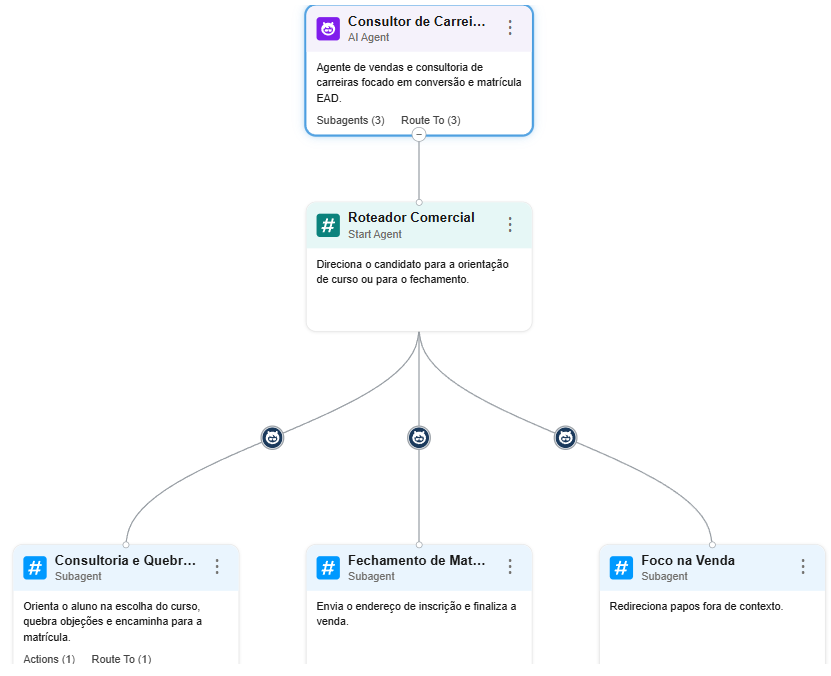
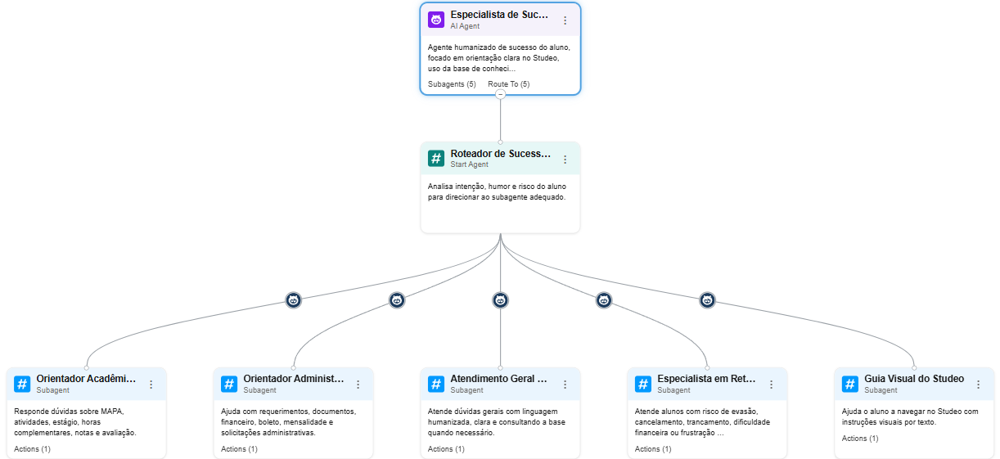
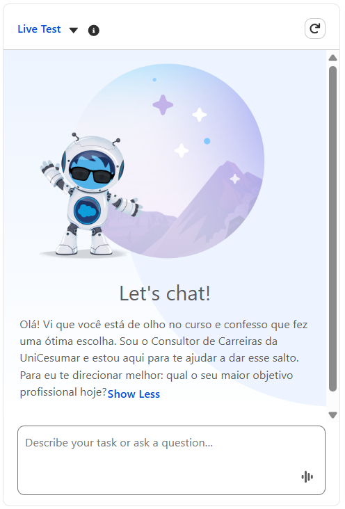
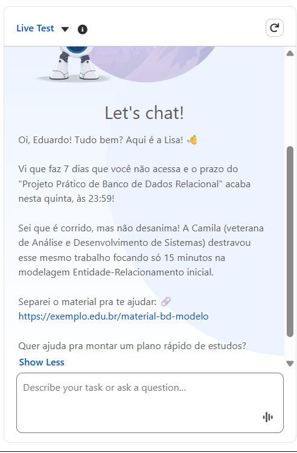

# 🏆 Marco Zero: Agentes Autônomos para Retenção EAD (Agentforce)

> **Solução Vencedora (1º Lugar Geral) no Hackathon Vitru 2026**  
> Desenvolvida durante uma maratona de 27 horas focada em combater o abandono acadêmico e potencializar o sucesso do estudante na educação a distância (EAD). 

Este repositório documenta a evolução e a arquitetura final da implementação de **Agentes de Inteligência Artificial Autônomos** focados em conversão e retenção humanizada.

---

## 🎯 O Desafio e a Solução (Pitch do Hackathon)

### O Problema: A Evasão Silenciosa no EAD
O abandono acadêmico raramente é um evento repentino. Ele é precedido por um rastro de atritos silenciosos: ausência de acolhimento inicial, quedas sutis na frequência de login, acúmulo de atividades e dúvidas não resolvidas. Quando a instituição percebe, o aluno já tomou a decisão de evadir.

### A Nossa Tese: Retenção Ponta a Ponta
Acreditamos que a mitigação da evasão começa muito antes da sala de aula. Se a venda e a seleção do aluno forem bem feitas e ele se sentir acolhido antes mesmo de realizar a matrícula, o engajamento inicial dispara. Se, durante o curso, ele for ativamente acompanhado e apoiado, ele permanece, conclui e ainda indica a instituição. 

Por isso, em vez de criar "chatbots comuns" com respostas engessadas, desenvolvemos dois Agentes Autônomos interligados:
* **Consultor de Carreiras (Pré-venda):** Focado em acolhimento, ancoragem vocacional e conversão com alinhamento de expectativas.
* **Lisa (Pós-venda e Sucesso):** Focada em intervenção proativa, suporte acadêmico e resgate humanizado.

### Fundamentação e Dados
A lógica de negócios, as métricas e os gatilhos dos agentes foram desenhados cruzando três fontes de dados estratégicas:
1. Bases de dados oficiais do desafio fornecidas pela Vitru Education.
2. Pesquisa aprofundada da equipe sobre o mercado de educação a distância.
3. A vivência real e dores diárias mapeadas por alunos ativos no EAD da UniCesumar.

---

## ⚙️ Estratégia de Viabilidade e Execução (Maratona de 27h)

A competição exigia a entrega de uma solução de alto impacto técnico e visual em tempo recorde. A arquitetura foi dividida em duas fases para garantir a máxima qualidade na apresentação final:

1. **Laboratório de Lógica (Antigravity, Kiro e Python):** 
   Não haveria tempo hábil para codificar uma plataforma inteira do zero que fosse visualmente impecável apenas com scripts Python. Utilizamos o ambiente de código, o Kiro e o Antigravity como laboratório para refinar a engenharia de prompts, estabelecer limites de segurança (guardrails), definir o tom de voz e estruturar as métricas comportamentais sem alucinações.
   
2. **Poder de Produção e Apresentação (Salesforce Agentforce):** 
   Com a lógica e os prompts unificados e altamente potencializados, migramos toda a inteligência para o ecossistema corporativo da Salesforce. O Agentforce Builder viabilizou a orquestração rápida dos Subagentes, a integração nativa com IA generativa e nos permitiu entregar um *Live Test* extremamente convincente, robusto e sem falhas durante o pitch para os jurados.

---

## 🤖 Engenharia de Agentes (Agent Definitions)

A solução final em produção utiliza a topologia de **Subagents** e **Roteadores de Intenção** nativos do Agentforce para garantir previsibilidade. O código fonte completo das definições (YAML/XML) está documentado na pasta `force-app/main/default`.

### 1. Consultor de Carreiras (Pré-venda UniCesumar)
Focado em conversão e ancoragem vocacional, operando como um *Closer* consultivo.

* **Lógica de Roteamento:**
  * **Roteador Comercial:** Identifica se o foco é dúvida de carreira (`go_to_course_guidance`) ou intenção imediata de matrícula (`go_to_enrollment_intent`).
  * **Consultoria e Quebra de Objeções:** Demonstra a matriz curricular e flexibilidade do EAD, ajustando variáveis dinâmicas de estado do lead (`course_confidence`).
  * **Foco na Venda (Anti-Desvio):** Redireciona papos fora de contexto para manter a segurança da interação.



### 2. Especialista de Sucesso do Aluno (Persona: Lisa)
Atua como um "concierge acadêmico humanizado", detectando sinais silenciosos de evasão e intervindo proativamente no pós-venda.

* **Inteligência Contextual e Guardrails:** O agente classifica o humor do aluno (neutro, frustrado, ansioso) e o risco de evasão (*churn_risk: low, medium, high*). Em casos de desabafo extremo ou crise financeira, o sistema bloqueia respostas genéricas e direciona o fluxo para intervenção humana.
* **Subagentes Mapeados:**
  * **Roteador de Sucesso do Aluno:** Usa o modelo `DefaultEinsteinHyperClassifier` para despachar o contexto.
  * **Orientador Acadêmico Didático:** Resolve dúvidas sobre MAPA, estágios e notas.
  * **Orientador Administrativo & Financeiro:** Descomplica requerimentos e boletos.
  * **Especialista em Retenção Humanizada:** Foco exclusivo em escuta ativa para alunos que sinalizam cancelamento.
  * **Guia Visual do Studeo:** Conduz o aluno passo a passo pela interface do AVA, criando independência tecnológica.



---

## 💬 Demonstrações em Tempo Real

<div align="center">
  <h3>Abordagem do Consultor de Carreiras</h3>
  <p>Foco na quebra de objeções e conversão através de ancoragem vocacional direcionada.</p>
  
</div>

<br>

<div align="center">
  <h3>Intervenção Proativa da Lisa</h3>
  <p>Atuação baseada em cruzamento de inatividade e proximidade de prazo de entrega.</p>
  
</div>

---

## 🛡️ Privacy by Design & LGPD

A transição para o Agentforce garantiu que a execução respeitasse a LGPD desde a concepção:
* **Minimização:** O agente acessa apenas variáveis de contexto necessárias (`@MessagingEndUser.ContactId`, `RoutableId`).
* **Regras Estritas de Prompt (System Instructions):** Impossibilidade de solicitação de senhas, endereços físicos precisos ou geração arbitrária de links de pagamento, ancorando as consultas exclusivamente ao `rag_feature_config_id`.

---

## 🚀 Próximos Passos: De Seattle para o Futuro com AWS

A conquista do 1º Lugar neste Hackathon nos levou diretamente a Seattle para uma imersão técnica na sede da **AWS (Executive Briefing Center)**, abrindo portas para a evolução natural da nossa arquitetura. 

**Como a AWS pode potencializar este projeto e a educação na Vitru como um todo?**

A nossa visão de futuro para o *Marco Zero* envolve a migração e orquestração de IA através do **Amazon Bedrock**. A flexibilidade do Bedrock nos permitirá sair de um modelo de linguagem único para uma abordagem multi-modelo (escolhendo o modelo fundacional ideal para cada subagente — por exemplo, utilizando a família *Claude 3* para empatia e raciocínio complexo na retenção, e o *Titan* para embeddings e análise estruturada de dados de evasão). Isso garante maior precisão, eficiência de custos e menor latência.

Para a Vitru em grande escala, a infraestrutura da AWS não atua apenas como hospedagem, mas como o motor de inteligência que escala o acolhimento humano. Ao conectar as interações dos agentes a um *Data Lake* na AWS, a instituição ganha capacidade analítica preditiva para antecipar a evasão antes mesmo que o aluno perceba a própria desmotivação, tudo sob uma infraestrutura com segurança de nível empresarial e total aderência à privacidade de dados.

---

## 🤝 A Equipe (Squad Vencedor)

O sucesso desta solução foi resultado de um esforço multidisciplinar de extrema colaboração e resiliência durante 27 horas ininterruptas:

* **Engenharia de IA e Arquitetura de Agentes:** Victória Suares e Cristiano Silva
* **Pesquisa, Negócios e Levantamento de Dados:** Yasmim Sobrinho
* **Pitch e Apresentação Executiva:** Eduardo Matos

---

## 📁 Estrutura do Repositório (Metadados Salesforce)

```text
marco-zero/
├── README.md
├── assets/
│   ├── arvore-consultor.png
│   ├── arvore-lisa.png
│   ├── demo-consultor.png
│   └── demo-lisa.png
└── force-app/main/default/
    ├── bots/                    # Definições base dos Agentes (XML)
    ├── genAiPlannerBundles/     # Ações locais e integrações de sistema
    └── genAiPlugins/            # Plugins de inteligência gerativa (Roteadores e Subagentes)
